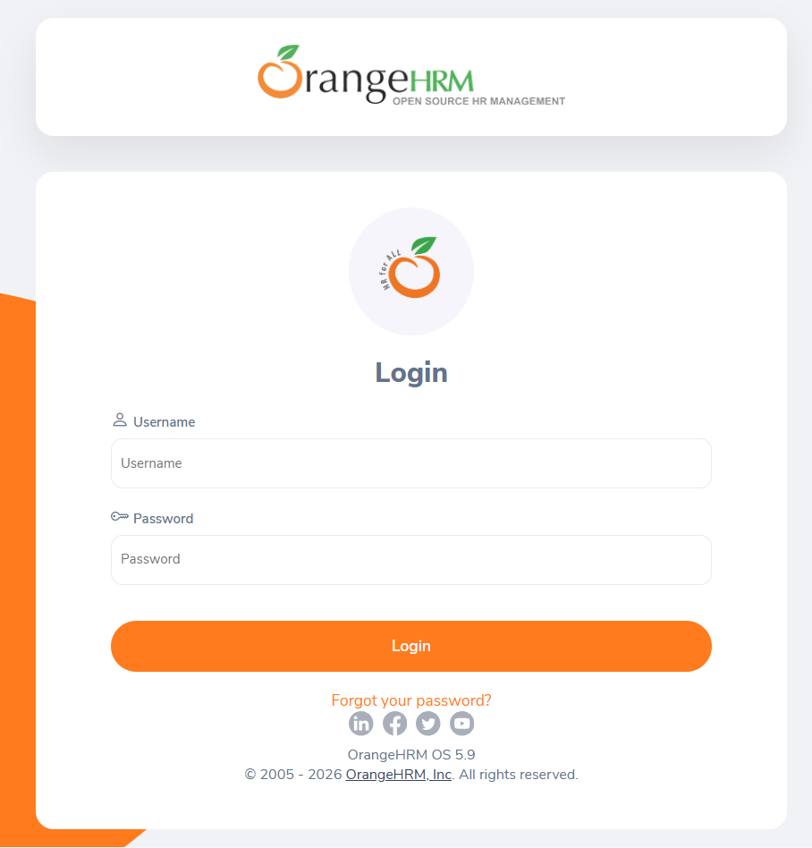

# Casos de teste — Navegação e permissões

## Referência visual

A captura mostra o formulário de autenticação da demo pública do OrangeHRM. O painel que exibe as credenciais da demo foi ocultado; use a imagem apenas como referência da interface, pois telas e permissões podem variar entre instalações.

## Preparação da matriz

Preencha a matriz abaixo antes da execução, incluindo as contas de teste e os escopos usados. Registre cada célula relevante como **Permitido**, **Negado** ou **N/A**. Célula em branco bloqueia o caso dependente. A ficha completa, com as linhas de PIM e Claim e campos para identificar as contas, está em [parâmetros da instância e dados de teste](parametros-instancia.md).

| Módulo/ação verificada | Admin | Supervisor | ESS |
|---|---|---|---|
| Ação permitida usada no ACC-001 (especificar) | | | |
| Ação negada usada no ACC-002 (especificar) | | | |
| PIM — consultar dados próprios | | | |
| PIM — consultar dados de subordinado | | | |
| PIM — consultar dados fora do escopo | | | |
| PIM — editar dados próprios | | | |
| PIM — editar dados de subordinado | | | |
| PIM — editar dados fora do escopo | | | |
| Outros módulos para ACC-006 (especificar) | | | |

Use contas de teste separadas e registros fictícios de escopo conhecido. Não presuma que os nomes dos perfis impliquem permissões idênticas em todas as instalações.

## ACC-001 — Acessar uma ação permitida

**Prioridade:** Alta  
**Pré-condições:** conta de teste; ação explicitamente permitida na matriz.

1. Entre com a conta.
2. Abra o módulo e execute a ação permitida em um registro de teste.

**Resultado esperado:** a célula escolhida na matriz está marcada **Permitido**; a ação pode ser concluída no registro de teste e o resultado fica visível ao usuário autorizado. Se não estiver marcada, bloqueie o caso.

## ACC-002 — Negar uma ação não permitida

**Prioridade:** Alta  
**Pré-condições:** conta de teste; ação explicitamente negada na matriz.

1. Entre com a conta.
2. Verifique se a ação está indisponível na interface.
3. Se houver uma URL direta conhecida para a ação, tente acessá-la sem executar alterações.

**Resultado esperado:** a célula escolhida está marcada **Negado**; a ação não é concluída e nenhum dado protegido é exibido ou alterado. Registre se a interface ocultou/desabilitou a ação ou exibiu a resposta de acesso negado; qualquer conclusão da ação reprova o caso.

## ACC-003 — Verificar permissões do Admin

**Prioridade:** Alta  
**Pré-condições:** conta Admin de teste e matriz de permissões confirmada.

1. Entre como Admin.
2. Verifique uma ação permitida e uma ação negada na matriz.

**Resultado esperado:** cada ação verificada produz exatamente o resultado **Permitido** ou **Negado** registrado na linha correspondente da matriz. Qualquer divergência reprova o caso.

## ACC-004 — Verificar permissões do Supervisor

**Prioridade:** Alta  
**Pré-condições:** conta Supervisor de teste e matriz confirmada; registro de teste pertinente ao escopo do supervisor.

1. Entre como Supervisor.
2. Consulte ou altere o registro conforme a permissão esperada.
3. Tente acessar um registro fora do escopo, se a matriz documentar essa restrição.

**Resultado esperado:** acesso a registros dentro e fora do escopo corresponde às células de consulta/edição para Supervisor. Uma ação marcada **Negado** não exibe dados protegidos nem altera o registro; qualquer divergência reprova o caso.

## ACC-005 — Verificar permissões do ESS

**Prioridade:** Alta  
**Pré-condições:** conta ESS de teste e matriz confirmada; dados próprios e de outro usuário de teste.

1. Entre como ESS.
2. Acesse as funções permitidas para a conta.
3. Tente consultar ou alterar dados de outro usuário apenas se a matriz negar esse acesso.

**Resultado esperado:** consulta e edição de dados próprios e de terceiros correspondem às células ESS da matriz. Acesso ou alteração em uma célula **Negado** reprova o caso; célula não preenchida bloqueia a verificação.

## ACC-006 — Navegar entre módulos disponíveis

**Prioridade:** Média  
**Pré-condições:** conta com acesso a pelo menos dois módulos.

1. Abra cada módulo autorizado pelo menu.
2. Retorne à página anterior ou use a navegação interna.

**Resultado esperado:** cada módulo escolhido abre a tela do módulo selecionado e corresponde a uma permissão **Permitido** na matriz; módulos não autorizados não exibem seus dados. Registre o módulo e a linha de matriz usados.

## ACC-007 — Bloquear acesso direto após logout

**Prioridade:** Alta  
**Pré-condições:** conta autenticada e URL de uma tela restrita conhecida.

1. Registre a URL da tela (sem parâmetros que contenham dados sensíveis).
2. Encerre a sessão pelo mecanismo de logout.
3. Tente abrir a URL registrada em uma nova navegação.

**Resultado esperado:** após o logout, a URL restrita não apresenta conteúdo da tela protegida e a página de login é exibida. Se qualquer dado restrito continuar visível, o caso reprova.

## ACC-008 — Não restaurar sessão protegida pelo botão Voltar

**Prioridade:** Média  
**Pré-condições:** conta autenticada e tela restrita visitada.

1. Encerre a sessão.
2. Use o botão Voltar do navegador para retornar à tela protegida.
3. Atualize a página, se o navegador oferecer essa opção.

**Resultado esperado:** após Voltar e atualizar, a aplicação exibe a página de login e nenhum dado da tela restrita fica visível. Qualquer conteúdo protegido acessível sem autenticação reprova o caso.
